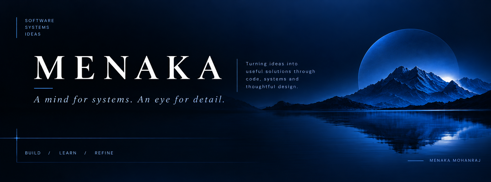

 

  

<em>Curious by nature. Deliberate by design.</em>

  

[Software](#04--technology) &nbsp; / &nbsp; [GitHub Stats](#05--github-activity) &nbsp; / &nbsp; [Repositories](https://github.com/Menaka0925?tab=repositories)

---

<table>
<tr>
<td width="60%" valign="top">

### 01 / THE PERSON

I'm a Computer Science graduate with a curious mind and a passion for understanding how technology works behind the scenes.

I enjoy exploring ideas, solving problems, and connecting software, systems, and creative thinking to build useful solutions.

My interests span software development, product thinking, and finding ways to make technology more intuitive and effective.

**Always learning. Always building. Always asking why.**

</td>
<td width="40%" valign="top">

### 02 / THE MINDSET

**01 — CURIOSITY**

Exploring beyond the obvious.

**02 — CLARITY**

Making complex things easier to understand.

**03 — CRAFT**

Caring about how the details come together.

**04 — GROWTH**

Learning through experimentation.

</td>
</tr>
</table>

---

### 03 / AREAS OF EXPLORATION

<table>
<tr>
<td align="center" width="33%">

**SOFTWARE**

Building useful things with code.

</td>
<td align="center" width="33%">

**SYSTEMS**

Understanding how the pieces connect.

</td>
<td align="center" width="33%">

**DESIGN & IDEAS**

Making technology feel thoughtful.

</td>
</tr>
</table>

---

### 04 / TECHNOLOGY

**LANGUAGES & FRONTEND**

      

**BACKEND & DATABASES**

    

**TOOLS & WORKFLOW**

    

---

### 05 / GITHUB ACTIVITY

  

---

### 06 / A THOUGHT TO BUILD BY

  

  

  

MENAKA MOHANRAJ

 

BUILDING &nbsp; / &nbsp; LEARNING &nbsp; / &nbsp; REFINING

